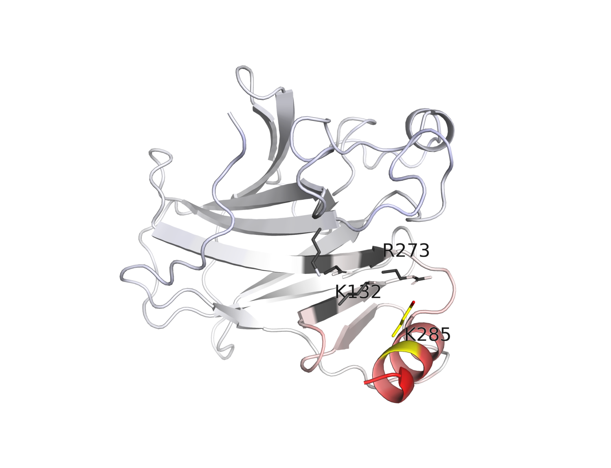
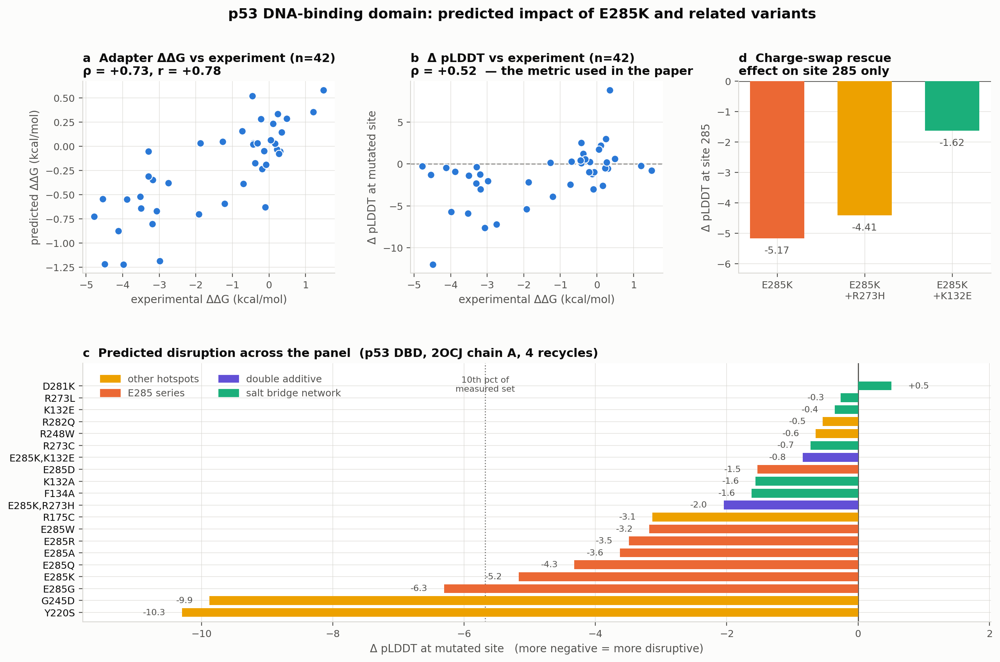

# p53 E285K — mutation impact in the DNA-binding domain

Worked example: scoring the melanoma-derived **p53(E285K)** variant of

> Dunsche L, Ivanisenko N, Riemann S, Schindler S, Beissert S, Angeli C, Kreis S,
> Tavassoli M, Lavrik I, Kulms D. *A cytosolic mutp53(E285K) variant confers
> chemoresistance of malignant melanoma.* Cell Death & Disease **14**:831 (2023).
> [doi:10.1038/s41419-023-06360-4](https://doi.org/10.1038/s41419-023-06360-4)

together with a substitution series at the same site, its salt-bridge partners,
other hotspots, and two double mutants — calibrated against 42 p53 variants with
measured ΔΔG.

**This is an independent check, not a reproduction.** The paper modelled E285K
with ESMFold + Rosetta on PDB 2ADY; this uses the AlphaFold2-derived AFToolkit
adapters on 2OCJ. Same conclusion by a different route.

<p align="center">
  
</p>

*Confidence lost on introducing E285K, mapped onto the structure. Red = the model
became less certain; the effect is confined to the C-terminal helix around the
mutated site (yellow), while the β-sandwich core is untouched. Generated by
`--pymol`.*

## Running it

Standalone: the structure is fetched from RCSB and the 42 calibration labels
ship with the example, so nothing outside the repo is needed except the
AlphaFold weights (auto-downloaded on first use).

```bash
# one variant, confidence only -- no trained adapters required  (~40 s)
python reproductions/p53_e285k/run_panel.py --only E285K --pymol --no-models

# full panel: 42 calibration + 20 panel mutations, ~30 min on an M-series GPU
python reproductions/p53_e285k/run_panel.py

# just the E285 series, with a PyMOL session per mutation
python reproductions/p53_e285k/run_panel.py --groups E285_series --pymol

# supply your own structure instead of fetching 2OCJ
python reproductions/p53_e285k/run_panel.py --pdb path/to/2OCJ.pdb

python reproductions/p53_e285k/analyse.py        # stats + the figure
```

Or for one mutation straight from the CLI:

```bash
aftoolkit predict --pdb 2OCJ.pdb --chain A --mutations E285K \
    --models "data/models/monomer/pair+lddt_logits+plddt/trained_*.pkl" \
    -n 4 --pymol --out-dir results
```

### The two output flags

| Flag | Effect |
|---|---|
| `--save-structures` / `--no-save-structures` | write the predicted wildtype and mutant PDBs (`<name>_wt.pdb`, `<name>_mt.pdb`) |
| `--pymol` | write `<name>_delta.pdb` (B-factor column = mutant − wildtype pLDDT), `<name>_delta.pml`, and a `<name>_delta.pse` session if PyMOL is on `PATH` |

AlphaFold stores per-residue pLDDT in the B-factor column, so differencing the
two predictions gives a per-residue map of *where the model became less sure* —
the spatial read-out a single ΔΔG number cannot provide. The session colours it
on a diverging ramp centred at zero (red = confidence lost, blue = gained) and
shows the mutated residues as sticks. Residues with no counterpart across the
pair (those an indel adds or removes) are set to 0.

Without PyMOL installed the `.pml` is still written, so the session can be built
later with `pymol -cq <name>_delta.pml`.

## Results

### 1. The salt-bridge network, recomputed from 2OCJ

Charged-tip distances measured directly from the crystal, chain A:

```
K164 —2.91Å— E271 —2.91Å— K132 —3.00Å— E285 —3.80Å— R273
```

A linear chain with **E285 at its centre**, the single link coupling K132 to
R273. E285 also packs against F134 (3.5 Å) and L130 (4.4 Å). This independently
recovers the network the paper names (E285, K132, E271, K164, R273), and makes
the mechanism concrete: a charge reversal at 285 repels *both* flanking partners
and breaks the chain at its midpoint — and R273 is itself the DNA-contact hotspot.

### 2. Calibration against 42 measured ΔΔG values



| Predictor | Spearman ρ | n |
|---|---|---|
| **adapter ensemble ΔΔG** | **+0.73** (p = 3·10⁻⁸), Pearson r = +0.78 | 42 |
| Δ pLDDT at site | +0.52 (p = 4·10⁻⁴) | 42 |
| Δ PAE at site | −0.63 | 42 |

Severely destabilising variants (exp. ΔΔG < −3, n = 13) separate from mild ones
(> −1, n = 23): mean Δ pLDDT −3.27 vs +0.39, Mann–Whitney p = 3·10⁻⁴.

Δ pLDDT — the proxy used in the paper — does track measured ΔΔG on p53, so the
approach is sound; the trained adapter carries more signal.

### 3. E285K

| Metric | Value | Percentile of the 42 measured variants |
|---|---|---|
| predicted ΔΔG | **−0.66 kcal/mol** | 19th |
| Δ pLDDT at 285 | **−5.17** | 14th |
| Δ PAE at 285 | **+1.38** | — |

In the most-disruptive ~15–20% of measured p53 variants, though short of severe
structural mutants (Y220S −10.3, G245D −9.9). An earlier run on an AlphaFold
model of the DBD gave −0.72 / −2.84, so this is not structure-specific.

Spatially, the lost confidence is concentrated at residues **281, 284, 285, 287,
288, 289** — the **aa281–294 region**, which is exactly the region the paper's
own Δ pLDDT analysis flagged.

### 4. The substitution series supports the charge mechanism

| Variant | Δ pLDDT at 285 | Charge at 285 |
|---|---|---|
| E285G | −6.31 | neutral, helix-breaking |
| **E285K** | **−5.17** | **reversed +** |
| E285Q | −4.32 | neutral, isosteric |
| E285A | −3.63 | neutral, truncated |
| E285R | −3.49 | reversed + |
| E285W | −3.18 | neutral, bulky |
| **E285D** | **−1.53** | **retained −** |

**E285D is the mildest of the series, 3.4× milder than E285K** — the one
substitution that keeps the negative charge, and hence the salt bridge. That is
what the network hypothesis predicts, and it is an internal control that did not
have to come out this way. Both charge reversals (K, R) are strongly disruptive,
consistent with the paper's finding that E285R also failed to restore cisplatin
sensitivity.

### 5. Contact mutants vs structural mutants

| Variant | predicted ΔΔG | Δ pLDDT | experimental ΔΔG |
|---|---|---|---|
| R273C | +0.76 | −0.72 | — |
| R273H | +0.52 | +0.45 | −0.45 |
| R248W | +0.27 | −0.65 | — |
| R248Q | +0.03 | −2.19 | −1.87 |
| R175C | +0.28 | −3.13 | — |

The classic DNA-contact hotspots come out **not destabilising** — which is correct
biology (they abolish DNA binding while leaving the fold intact; measured R273H
ΔΔG is −0.45), but means **stability prediction alone cannot flag them**.

That is what makes E285K notable: it behaves like a *structural* perturbation
(Δ pLDDT −5.17) rather than a contact mutant (R273H, +0.45), despite sharing the
loss-of-DNA-binding phenotype — supporting an indirect, conformational mechanism.

### 6. A testable prediction: a compensatory second mutation

Δ pLDDT at residue 285 only, for each candidate second site:

| Construct | Δ pLDDT at 285 | Recovered | Second site is… |
|---|---|---|---|
| E285K | −5.17 | — | the variant alone |
| **E285K + K132E** | **−1.62** | **69%** | direct partner, charge reversed |
| **E285K + R273E** | **−2.27** | **56%** | the other direct partner, charge reversed |
| E285K + K132D | −4.04 | 22% | same charge, one CH₂ shorter |
| E285K + E271K | −4.22 | 18% | second shell, not in contact with 285 |
| E285K + R273H | −4.41 | 15% | same site as R273E, but *not* charge-reversed |
| E285K + D281K | −5.72 | none (worse) | nearby, outside the chain |

Both direct partners rescue when charge-reversed; the same sites mutated the
wrong way do not, and neither does a second-shell or off-chain site. K132D
carries the same charge as K132E but is one methylene shorter and recovers a
third as much, so the geometry of the ion pair matters too — which is what makes
this look like a real salt bridge rather than a generic perturbation.

**Caveats.** This comes from the AlphaFold confidence of the double-mutant
structure, *not* the adapter ΔΔG — the adapters are additive by construction
(`multi_as_singlessum=True`) and cannot represent epistasis. Each value is one
deterministic prediction with no error bars, and pLDDT is not a free energy.
Every double also strips one extra template side chain; D281K and R273H are the
controls for that, and show no rescue. A hypothesis worth a construct, not
evidence.

K132E alone is predicted destabilising (ΔΔG −0.67, essentially tied with E285K),
consistent with the paper's observation that K132E reconstitution phenocopies
E285K in conferring chemoresistance.

## What this cannot say

The adapters predict **ΔΔG of folding stability**. Nothing here predicts
transcriptional activity, cytosolic vs nuclear localisation, ubiquitination,
tetramerisation or chemoresistance — the actual phenotypes in the paper. The
structural claim is what these numbers support; the link from there to
mislocalisation remains the paper's experimental result.

## Files

| Path | Contents |
|---|---|
| `run_panel.py` | driver: calibration set + panel, with `--pymol` / `--save-structures` |
| `p53_benchmark.csv` | the 42 calibration mutations with experimental ΔΔG (ships with the example) |
| `analyse.py` | correlations, percentile ranking, the summary figure |
| `results/p53_results.csv` | all 62 mutations: ΔΔG per model + ensemble, Δ pLDDT, Δ PAE, Δ pTM |
| `results/p53_mutation_panel.png` | calibration, ranked panel, charge-swap rescue |
| `results/E285K_delta.{pdb,pml,png}` | confidence-difference structure, PyMOL script, render |
| | rebuild the session with `cd results && pymol -cq E285K_delta.pml` |
| `results/reports/*.json` | per-mutation reports (kept for the rescue panel) |

Structure: PDB **2OCJ** chain A (p53 core domain, residues 96–289), 4 recycles,
masked-template pipeline, three published monomer adapters.

**On the ΔΔG column:** it needs the trained monomer adapters, which are not in
the repository (`data/models/` is gitignored, and the upstream download host
currently refuses anonymous reads). Without them the run still produces every
confidence metric — Δ pLDDT, Δ PAE, Δ pTM and the PyMOL map — which is what the
structural argument above rests on. See *Rebuilding the adapters* in the top-level
README to train your own from cached features.
